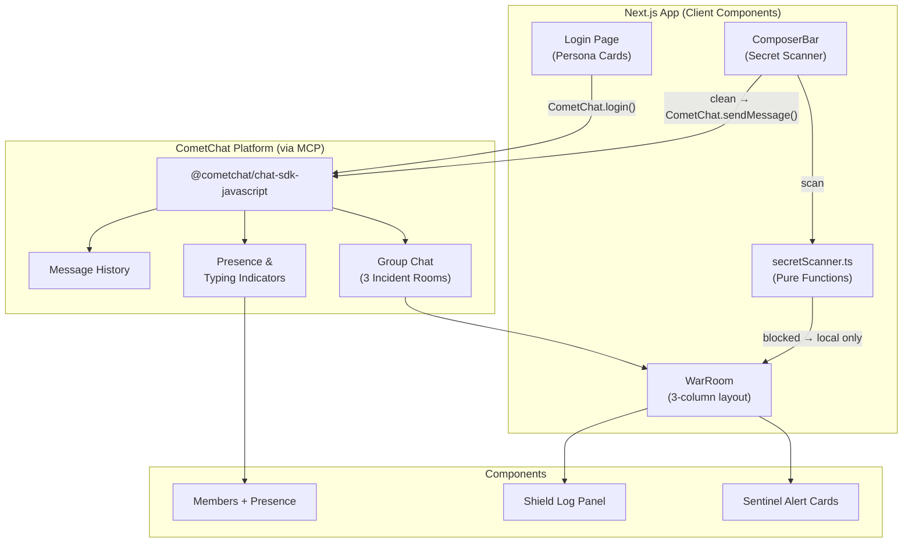

# IncidentRoom 🛡️

> **Incident chat that stops credential leaks. Live.**

## One-Line Pitch

A real-time security incident war-room powered by CometChat where responders collaborate — and the chat itself detects and blocks credential leaks before they spread.

## The Problem

During a security incident, responders under pressure often accidentally paste real AWS keys, tokens, or connection strings into chat tools. Once a secret hits a group chat, it's compromised — logged forever, seen by too many eyes.

## How It Works

1. **Three personas** — Asha (SOC Analyst), Ravi (Incident Lead), Sentinel (bot) — join incident rooms
2. **CometChat** powers all real-time group messaging, presence, and typing indicators
3. **Secret Shield** scans every keystroke as you type, underlines detected secrets in red, and **blocks the message** before it is ever sent to CometChat
4. **Sentinel** posts structured threat intelligence alerts and can summarize the last 20 messages deterministically
5. **Demo mode** plays a scripted 60-second scenario showing the full flow end-to-end

## Screenshots

_[Screenshot: Login screen with persona cards]_

_[Screenshot: War room with Sentinel alert]_

_[Screenshot: Secret blocked mid-typing with red underline]_

## Quick Start

### Prerequisites
- Node.js ≥ 18
- A [CometChat account](https://app.cometchat.com) (free tier works)

### Setup

```bash
git clone <repo>
cd incidentroom
cp .env.example .env.local
# Fill in your credentials in .env.local
npm install
npm run dev
```

Open [http://localhost:3000](http://localhost:3000).

### Environment Variables (Vercel)

| Variable | Description |
|----------|-------------|
| `NEXT_PUBLIC_COMETCHAT_APP_ID` | Your CometChat App ID |
| `NEXT_PUBLIC_COMETCHAT_REGION` | Region (`us`, `eu`, `in`) |
| `NEXT_PUBLIC_COMETCHAT_AUTH_KEY` | Auth Key (dev/demo only) |

> **Security note:** Auth Key login is used for this hackathon demo. In production, replace with server-generated Auth Tokens. The Auth Key should never be exposed in production apps.

## Architecture



## Built with the CometChat MCP

**MCP Server:** `https://mcp.cometchat.com/mcp`

### MCP Tools Called

| Tool | Purpose |
|------|---------|
| `list_cometchat_bundles` | Listed all available implementation bundles |
| `get_cometchat_implementation_bundle` | Pulled `react-js-sdk-quickstart` bundle |
| `search_cometchat_docs` | Searched for presence, typing, group messaging APIs |
| `fetch_cometchat_doc_page` | Fetched JavaScript SDK overview and messaging pages |

### Bundles Used

| Bundle | What We Used |
|--------|-------------|
| `react-js-sdk-quickstart` | `AppSettingsBuilder`, `init()`, `login()`, `getLoggedinUser()` |
| `presence-typing-indicators` | `subscribePresenceForAllUsers()`, `startTyping()`, `endTyping()`, `UserListener` |
| `group-chat` | `GroupsRequestBuilder`, `MessagesRequestBuilder`, `sendMessage()`, group creation/join |

### CometChat Features Used

- `CometChat.init()` with `AppSettingsBuilder`
- `CometChat.login()` with Auth Key
- `CometChat.createUser()` / `CometChat.updateUser()`
- `CometChat.createGroup()` / `CometChat.joinGroup()`
- `CometChat.sendMessage()` with TextMessage + metadata
- `MessagesRequestBuilder` for message history
- `GroupMembersRequestBuilder` for member lists
- `MessageListener` for real-time messages
- `UserListener` for presence (online/offline)
- `TypingIndicator` + `startTyping()` / `endTyping()`

## Features

- ✅ Real-time group chat via CometChat
- ✅ Message history with auto-scroll
- ✅ Typing indicators ("Ravi is typing...")
- ✅ Online/offline presence dots
- ✅ Sentinel structured alert cards
- ✅ **Secret Shield** — blocks AWS keys, GitHub tokens, Slack tokens, Stripe keys, private keys, JWTs, password=, api_key=, connection strings
- ✅ Live secret underline highlighting while typing
- ✅ Blocked message card with redacted preview + "Send redacted" button
- ✅ Shield stats widget (persisted to localStorage per room)
- ✅ Simulate Alert button (random threat intelligence)
- ✅ Summarize Incident button (deterministic, no LLM)
- ✅ Escalate (Ravi only) — flips severity to CRITICAL with pulse animation
- ✅ Incident timer
- ✅ Demo Mode — 60-second scripted scenario
- ✅ Dark security ops theme

## Limitations

- Auth Key login is used (not production-safe, requires server-side Auth Token in prod)
- Seed messages are sent as the logged-in user with metadata for display (REST API batch sends would be more accurate)
- Moderation server-side rules require CometChat Dashboard setup (documented in DEMO_SCRIPT.md)
- No message reactions or threads (cut to keep scope manageable)
# IncidentRoom
